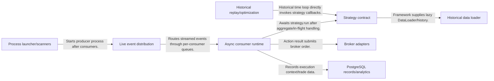
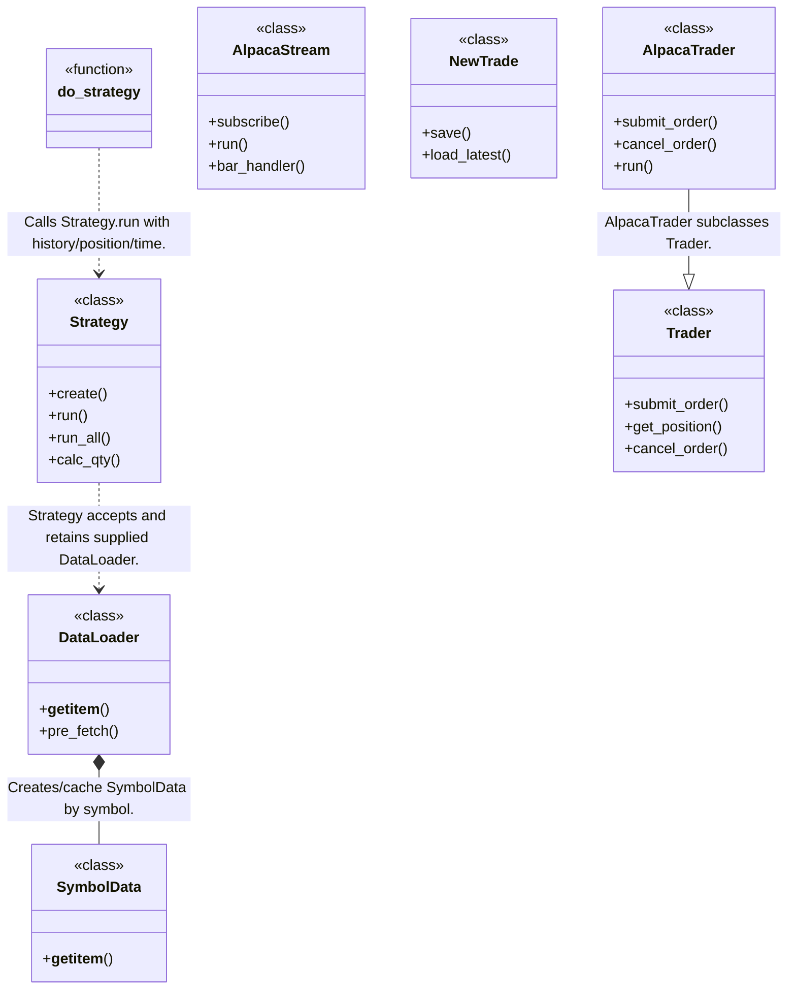
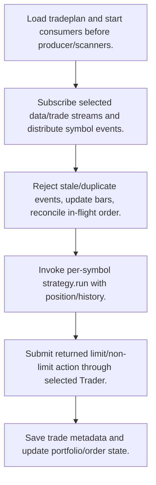
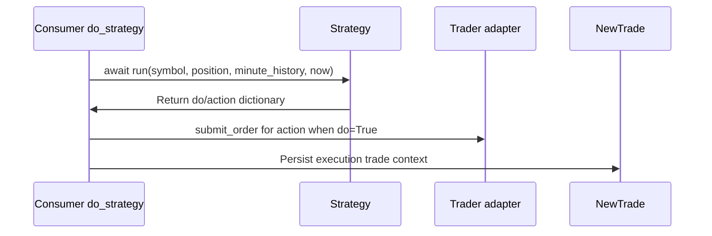

# LiuAlgoTrader: workflow, design and architecture

Updated: **2026-10-13**
Reviewed Git hash: `415d67259015f0a258bb9d92a8a46daa43b17086`
Branch: `feature/ayu_develop`
Source diff SHA256: `e3b0c44298fc1c149afbf4c8996fb92427ae41e4649b934ca495991b7852b855`
Scope: **Multiprocess equities / crypto strategy framework** / Maintenance: **active**
Languages: Python

[HTML edition](ayu-develop.html) / [Development](development.md) / [Historical validation](validation.md) / [Full system comparison](../../docs/index.html)

## Purpose and scope

Scan symbols, distribute live market events to process-local async consumers, invoke strategies and broker adapters, and run direct historical replay with PostgreSQL trade/portfolio records.

## Features and support boundaries

Native = implemented here. Integration = supplied through a named host/API. Limited = material restriction. Not provided = evidenced scope exclusion. Unverified = support/absence not established. Not applicable = outside this artifact type.

| Capability | Status | Implementation and limits | Source |
|---|---|---|---|
| Backtesting | Native | Framework supplies time-step historical replay, queue-driven consumer hooks and broker action/order lifecycle adapters plus process launcher. | [backtest_day](../src/liualgotrader/enhanced_backtest.py) ([L346](https://github.com/alexcwyu/LiuAlgoTrader/blob/415d67259015f0a258bb9d92a8a46daa43b17086/src/liualgotrader/enhanced_backtest.py#L346)) / [handle_data_queue_msg](../src/liualgotrader/consumer.py) ([L727](https://github.com/alexcwyu/LiuAlgoTrader/blob/415d67259015f0a258bb9d92a8a46daa43b17086/src/liualgotrader/consumer.py#L727)) / [handle_aggregate](../src/liualgotrader/consumer.py) ([L697](https://github.com/alexcwyu/LiuAlgoTrader/blob/415d67259015f0a258bb9d92a8a46daa43b17086/src/liualgotrader/consumer.py#L697)) / [do_strategy](../src/liualgotrader/consumer.py) ([L617](https://github.com/alexcwyu/LiuAlgoTrader/blob/415d67259015f0a258bb9d92a8a46daa43b17086/src/liualgotrader/consumer.py#L617)) / [submit_order](../src/liualgotrader/consumer.py) ([L547](https://github.com/alexcwyu/LiuAlgoTrader/blob/415d67259015f0a258bb9d92a8a46daa43b17086/src/liualgotrader/consumer.py#L547)) / [main_cli](../src/liualgotrader/scripts/trader.py) ([L32](https://github.com/alexcwyu/LiuAlgoTrader/blob/415d67259015f0a258bb9d92a8a46daa43b17086/src/liualgotrader/scripts/trader.py#L32)) |
| Live execution | Integration | Configured broker/feed adapters (Alpaca and selected broker factory) depend on external credentials/data services; local loaders/streams route data to strategy runtime. | [AlpacaTrader.__init__](../src/liualgotrader/trading/alpaca.py) ([L26](https://github.com/alexcwyu/LiuAlgoTrader/blob/415d67259015f0a258bb9d92a8a46daa43b17086/src/liualgotrader/trading/alpaca.py#L26)) / [trader_factory](../src/liualgotrader/trading/trader_factory.py) ([L13](https://github.com/alexcwyu/LiuAlgoTrader/blob/415d67259015f0a258bb9d92a8a46daa43b17086/src/liualgotrader/trading/trader_factory.py#L13)) / [AlpacaData.crypto_get_symbol_data](../src/liualgotrader/data/alpaca.py) ([L230](https://github.com/alexcwyu/LiuAlgoTrader/blob/415d67259015f0a258bb9d92a8a46daa43b17086/src/liualgotrader/data/alpaca.py#L230)) / [AlpacaStream.subscribe](../src/liualgotrader/data/alpaca.py) ([L626](https://github.com/alexcwyu/LiuAlgoTrader/blob/415d67259015f0a258bb9d92a8a46daa43b17086/src/liualgotrader/data/alpaca.py#L626)) / [DataLoader.__getitem__](../src/liualgotrader/common/data_loader.py) ([L658](https://github.com/alexcwyu/LiuAlgoTrader/blob/415d67259015f0a258bb9d92a8a46daa43b17086/src/liualgotrader/common/data_loader.py#L658)) |
| Paper trading | Integration | Alpaca adapter forwards configured APCA_API_BASE_URL to REST/Stream; broker-side paper endpoint is configurable, not a dedicated local paper matching engine. No paper endpoint operation verified. | [AlpacaTrader.__init__](../src/liualgotrader/trading/alpaca.py) ([L26](https://github.com/alexcwyu/LiuAlgoTrader/blob/415d67259015f0a258bb9d92a8a46daa43b17086/src/liualgotrader/trading/alpaca.py#L26)) |
| Event driven | Native | Framework supplies time-step historical replay, queue-driven consumer hooks and broker action/order lifecycle adapters plus process launcher. | [backtest_day](../src/liualgotrader/enhanced_backtest.py) ([L346](https://github.com/alexcwyu/LiuAlgoTrader/blob/415d67259015f0a258bb9d92a8a46daa43b17086/src/liualgotrader/enhanced_backtest.py#L346)) / [handle_data_queue_msg](../src/liualgotrader/consumer.py) ([L727](https://github.com/alexcwyu/LiuAlgoTrader/blob/415d67259015f0a258bb9d92a8a46daa43b17086/src/liualgotrader/consumer.py#L727)) / [handle_aggregate](../src/liualgotrader/consumer.py) ([L697](https://github.com/alexcwyu/LiuAlgoTrader/blob/415d67259015f0a258bb9d92a8a46daa43b17086/src/liualgotrader/consumer.py#L697)) / [do_strategy](../src/liualgotrader/consumer.py) ([L617](https://github.com/alexcwyu/LiuAlgoTrader/blob/415d67259015f0a258bb9d92a8a46daa43b17086/src/liualgotrader/consumer.py#L617)) / [submit_order](../src/liualgotrader/consumer.py) ([L547](https://github.com/alexcwyu/LiuAlgoTrader/blob/415d67259015f0a258bb9d92a8a46daa43b17086/src/liualgotrader/consumer.py#L547)) / [main_cli](../src/liualgotrader/scripts/trader.py) ([L32](https://github.com/alexcwyu/LiuAlgoTrader/blob/415d67259015f0a258bb9d92a8a46daa43b17086/src/liualgotrader/scripts/trader.py#L32)) |
| Vectorized | Limited | DataLoader/analytics use DataFrames; trading/replay loops execute strategy callbacks serially per timestamp/symbol. | [backtest_day](../src/liualgotrader/enhanced_backtest.py) ([L346](https://github.com/alexcwyu/LiuAlgoTrader/blob/415d67259015f0a258bb9d92a8a46daa43b17086/src/liualgotrader/enhanced_backtest.py#L346)) / [portfolio_return](../src/liualgotrader/analytics/analysis.py) ([L40](https://github.com/alexcwyu/LiuAlgoTrader/blob/415d67259015f0a258bb9d92a8a46daa43b17086/src/liualgotrader/analytics/analysis.py#L40)) |
| Order management | Native | Framework supplies time-step historical replay, queue-driven consumer hooks and broker action/order lifecycle adapters plus process launcher. | [backtest_day](../src/liualgotrader/enhanced_backtest.py) ([L346](https://github.com/alexcwyu/LiuAlgoTrader/blob/415d67259015f0a258bb9d92a8a46daa43b17086/src/liualgotrader/enhanced_backtest.py#L346)) / [handle_data_queue_msg](../src/liualgotrader/consumer.py) ([L727](https://github.com/alexcwyu/LiuAlgoTrader/blob/415d67259015f0a258bb9d92a8a46daa43b17086/src/liualgotrader/consumer.py#L727)) / [handle_aggregate](../src/liualgotrader/consumer.py) ([L697](https://github.com/alexcwyu/LiuAlgoTrader/blob/415d67259015f0a258bb9d92a8a46daa43b17086/src/liualgotrader/consumer.py#L697)) / [do_strategy](../src/liualgotrader/consumer.py) ([L617](https://github.com/alexcwyu/LiuAlgoTrader/blob/415d67259015f0a258bb9d92a8a46daa43b17086/src/liualgotrader/consumer.py#L617)) / [submit_order](../src/liualgotrader/consumer.py) ([L547](https://github.com/alexcwyu/LiuAlgoTrader/blob/415d67259015f0a258bb9d92a8a46daa43b17086/src/liualgotrader/consumer.py#L547)) / [main_cli](../src/liualgotrader/scripts/trader.py) ([L32](https://github.com/alexcwyu/LiuAlgoTrader/blob/415d67259015f0a258bb9d92a8a46daa43b17086/src/liualgotrader/scripts/trader.py#L32)) |
| Order types | Limited | Consumer supports limit action or requested non-limit broker type with day TIF; broker-specific acceptance is external. | [submit_order](../src/liualgotrader/consumer.py) ([L547](https://github.com/alexcwyu/LiuAlgoTrader/blob/415d67259015f0a258bb9d92a8a46daa43b17086/src/liualgotrader/consumer.py#L547)) |
| Multi venue | Limited | Factory selects Alpaca/Gemini/Tradier, but producer explicitly records TODO support multiple brokers; configured broker selection is not simultaneous cross-venue execution. | [trader_factory](../src/liualgotrader/trading/trader_factory.py) ([L13](https://github.com/alexcwyu/LiuAlgoTrader/blob/415d67259015f0a258bb9d92a8a46daa43b17086/src/liualgotrader/trading/trader_factory.py#L13)) / [producer_async_main](../src/liualgotrader/producer.py) ([L204](https://github.com/alexcwyu/LiuAlgoTrader/blob/415d67259015f0a258bb9d92a8a46daa43b17086/src/liualgotrader/producer.py#L204)) |
| Crypto | Integration | Configured broker/feed adapters (Alpaca and selected broker factory) depend on external credentials/data services; local loaders/streams route data to strategy runtime. | [AlpacaTrader.__init__](../src/liualgotrader/trading/alpaca.py) ([L26](https://github.com/alexcwyu/LiuAlgoTrader/blob/415d67259015f0a258bb9d92a8a46daa43b17086/src/liualgotrader/trading/alpaca.py#L26)) / [trader_factory](../src/liualgotrader/trading/trader_factory.py) ([L13](https://github.com/alexcwyu/LiuAlgoTrader/blob/415d67259015f0a258bb9d92a8a46daa43b17086/src/liualgotrader/trading/trader_factory.py#L13)) / [AlpacaData.crypto_get_symbol_data](../src/liualgotrader/data/alpaca.py) ([L230](https://github.com/alexcwyu/LiuAlgoTrader/blob/415d67259015f0a258bb9d92a8a46daa43b17086/src/liualgotrader/data/alpaca.py#L230)) / [AlpacaStream.subscribe](../src/liualgotrader/data/alpaca.py) ([L626](https://github.com/alexcwyu/LiuAlgoTrader/blob/415d67259015f0a258bb9d92a8a46daa43b17086/src/liualgotrader/data/alpaca.py#L626)) / [DataLoader.__getitem__](../src/liualgotrader/common/data_loader.py) ([L658](https://github.com/alexcwyu/LiuAlgoTrader/blob/415d67259015f0a258bb9d92a8a46daa43b17086/src/liualgotrader/common/data_loader.py#L658)) |
| Equities | Integration | Configured broker/feed adapters (Alpaca and selected broker factory) depend on external credentials/data services; local loaders/streams route data to strategy runtime. | [AlpacaTrader.__init__](../src/liualgotrader/trading/alpaca.py) ([L26](https://github.com/alexcwyu/LiuAlgoTrader/blob/415d67259015f0a258bb9d92a8a46daa43b17086/src/liualgotrader/trading/alpaca.py#L26)) / [trader_factory](../src/liualgotrader/trading/trader_factory.py) ([L13](https://github.com/alexcwyu/LiuAlgoTrader/blob/415d67259015f0a258bb9d92a8a46daa43b17086/src/liualgotrader/trading/trader_factory.py#L13)) / [AlpacaData.crypto_get_symbol_data](../src/liualgotrader/data/alpaca.py) ([L230](https://github.com/alexcwyu/LiuAlgoTrader/blob/415d67259015f0a258bb9d92a8a46daa43b17086/src/liualgotrader/data/alpaca.py#L230)) / [AlpacaStream.subscribe](../src/liualgotrader/data/alpaca.py) ([L626](https://github.com/alexcwyu/LiuAlgoTrader/blob/415d67259015f0a258bb9d92a8a46daa43b17086/src/liualgotrader/data/alpaca.py#L626)) / [DataLoader.__getitem__](../src/liualgotrader/common/data_loader.py) ([L658](https://github.com/alexcwyu/LiuAlgoTrader/blob/415d67259015f0a258bb9d92a8a46daa43b17086/src/liualgotrader/common/data_loader.py#L658)) |
| Futures | Unverified | Representative source review did not establish this capability; no claim of absence. | Not applicable to this repository scope. |
| Options | Unverified | Representative source review did not establish this capability; no claim of absence. | Not applicable to this repository scope. |
| Forex | Unverified | Representative source review did not establish this capability; no claim of absence. | Not applicable to this repository scope. |
| Strategy api | Native | Framework supplies time-step historical replay, queue-driven consumer hooks and broker action/order lifecycle adapters plus process launcher. | [backtest_day](../src/liualgotrader/enhanced_backtest.py) ([L346](https://github.com/alexcwyu/LiuAlgoTrader/blob/415d67259015f0a258bb9d92a8a46daa43b17086/src/liualgotrader/enhanced_backtest.py#L346)) / [handle_data_queue_msg](../src/liualgotrader/consumer.py) ([L727](https://github.com/alexcwyu/LiuAlgoTrader/blob/415d67259015f0a258bb9d92a8a46daa43b17086/src/liualgotrader/consumer.py#L727)) / [handle_aggregate](../src/liualgotrader/consumer.py) ([L697](https://github.com/alexcwyu/LiuAlgoTrader/blob/415d67259015f0a258bb9d92a8a46daa43b17086/src/liualgotrader/consumer.py#L697)) / [do_strategy](../src/liualgotrader/consumer.py) ([L617](https://github.com/alexcwyu/LiuAlgoTrader/blob/415d67259015f0a258bb9d92a8a46daa43b17086/src/liualgotrader/consumer.py#L617)) / [submit_order](../src/liualgotrader/consumer.py) ([L547](https://github.com/alexcwyu/LiuAlgoTrader/blob/415d67259015f0a258bb9d92a8a46daa43b17086/src/liualgotrader/consumer.py#L547)) / [main_cli](../src/liualgotrader/scripts/trader.py) ([L32](https://github.com/alexcwyu/LiuAlgoTrader/blob/415d67259015f0a258bb9d92a8a46daa43b17086/src/liualgotrader/scripts/trader.py#L32)) |
| Optimization | Native | Parameter iteration wrapper invokes enhanced backtest and saves optimizer run record. | [backtest_iteration](../src/liualgotrader/backtesting/optimizer.py) ([L22](https://github.com/alexcwyu/LiuAlgoTrader/blob/415d67259015f0a258bb9d92a8a46daa43b17086/src/liualgotrader/backtesting/optimizer.py#L22)) |
| Machine learning | Unverified | Representative source review did not establish this capability; no claim of absence. | Not applicable to this repository scope. |
| Reinforcement learning | Unverified | Representative source review did not establish this capability; no claim of absence. | Not applicable to this repository scope. |
| Portfolio | Native | DB models persist portfolios/trades and analysis aggregates daily/strategy cash returns; this is not a universal portfolio accounting proof. | [Portfolio.save](../src/liualgotrader/models/portfolio.py) ([L79](https://github.com/alexcwyu/LiuAlgoTrader/blob/415d67259015f0a258bb9d92a8a46daa43b17086/src/liualgotrader/models/portfolio.py#L79)) / [NewTrade.save](../src/liualgotrader/models/new_trades.py) ([L39](https://github.com/alexcwyu/LiuAlgoTrader/blob/415d67259015f0a258bb9d92a8a46daa43b17086/src/liualgotrader/models/new_trades.py#L39)) / [portfolio_return](../src/liualgotrader/analytics/analysis.py) ([L40](https://github.com/alexcwyu/LiuAlgoTrader/blob/415d67259015f0a258bb9d92a8a46daa43b17086/src/liualgotrader/analytics/analysis.py#L40)) |
| Risk management | Limited | Strategy calc_qty constrains size by account cash/fee; stop/target metadata persists. Strategy schedule windows explicitly are not platform-enforced. | [Strategy.calc_qty](../src/liualgotrader/strategies/base.py) ([L63](https://github.com/alexcwyu/LiuAlgoTrader/blob/415d67259015f0a258bb9d92a8a46daa43b17086/src/liualgotrader/strategies/base.py#L63)) / [Strategy](../src/liualgotrader/strategies/base.py) ([L24](https://github.com/alexcwyu/LiuAlgoTrader/blob/415d67259015f0a258bb9d92a8a46daa43b17086/src/liualgotrader/strategies/base.py#L24)) / [NewTrade.save](../src/liualgotrader/models/new_trades.py) ([L39](https://github.com/alexcwyu/LiuAlgoTrader/blob/415d67259015f0a258bb9d92a8a46daa43b17086/src/liualgotrader/models/new_trades.py#L39)) |
| Performance analytics | Native | DB models persist portfolios/trades and analysis aggregates daily/strategy cash returns; this is not a universal portfolio accounting proof. | [Portfolio.save](../src/liualgotrader/models/portfolio.py) ([L79](https://github.com/alexcwyu/LiuAlgoTrader/blob/415d67259015f0a258bb9d92a8a46daa43b17086/src/liualgotrader/models/portfolio.py#L79)) / [NewTrade.save](../src/liualgotrader/models/new_trades.py) ([L39](https://github.com/alexcwyu/LiuAlgoTrader/blob/415d67259015f0a258bb9d92a8a46daa43b17086/src/liualgotrader/models/new_trades.py#L39)) / [portfolio_return](../src/liualgotrader/analytics/analysis.py) ([L40](https://github.com/alexcwyu/LiuAlgoTrader/blob/415d67259015f0a258bb9d92a8a46daa43b17086/src/liualgotrader/analytics/analysis.py#L40)) |
| Historical data | Integration | Configured broker/feed adapters (Alpaca and selected broker factory) depend on external credentials/data services; local loaders/streams route data to strategy runtime. | [AlpacaTrader.__init__](../src/liualgotrader/trading/alpaca.py) ([L26](https://github.com/alexcwyu/LiuAlgoTrader/blob/415d67259015f0a258bb9d92a8a46daa43b17086/src/liualgotrader/trading/alpaca.py#L26)) / [trader_factory](../src/liualgotrader/trading/trader_factory.py) ([L13](https://github.com/alexcwyu/LiuAlgoTrader/blob/415d67259015f0a258bb9d92a8a46daa43b17086/src/liualgotrader/trading/trader_factory.py#L13)) / [AlpacaData.crypto_get_symbol_data](../src/liualgotrader/data/alpaca.py) ([L230](https://github.com/alexcwyu/LiuAlgoTrader/blob/415d67259015f0a258bb9d92a8a46daa43b17086/src/liualgotrader/data/alpaca.py#L230)) / [AlpacaStream.subscribe](../src/liualgotrader/data/alpaca.py) ([L626](https://github.com/alexcwyu/LiuAlgoTrader/blob/415d67259015f0a258bb9d92a8a46daa43b17086/src/liualgotrader/data/alpaca.py#L626)) / [DataLoader.__getitem__](../src/liualgotrader/common/data_loader.py) ([L658](https://github.com/alexcwyu/LiuAlgoTrader/blob/415d67259015f0a258bb9d92a8a46daa43b17086/src/liualgotrader/common/data_loader.py#L658)) |
| Streaming data | Integration | Configured broker/feed adapters (Alpaca and selected broker factory) depend on external credentials/data services; local loaders/streams route data to strategy runtime. | [AlpacaTrader.__init__](../src/liualgotrader/trading/alpaca.py) ([L26](https://github.com/alexcwyu/LiuAlgoTrader/blob/415d67259015f0a258bb9d92a8a46daa43b17086/src/liualgotrader/trading/alpaca.py#L26)) / [trader_factory](../src/liualgotrader/trading/trader_factory.py) ([L13](https://github.com/alexcwyu/LiuAlgoTrader/blob/415d67259015f0a258bb9d92a8a46daa43b17086/src/liualgotrader/trading/trader_factory.py#L13)) / [AlpacaData.crypto_get_symbol_data](../src/liualgotrader/data/alpaca.py) ([L230](https://github.com/alexcwyu/LiuAlgoTrader/blob/415d67259015f0a258bb9d92a8a46daa43b17086/src/liualgotrader/data/alpaca.py#L230)) / [AlpacaStream.subscribe](../src/liualgotrader/data/alpaca.py) ([L626](https://github.com/alexcwyu/LiuAlgoTrader/blob/415d67259015f0a258bb9d92a8a46daa43b17086/src/liualgotrader/data/alpaca.py#L626)) / [DataLoader.__getitem__](../src/liualgotrader/common/data_loader.py) ([L658](https://github.com/alexcwyu/LiuAlgoTrader/blob/415d67259015f0a258bb9d92a8a46daa43b17086/src/liualgotrader/common/data_loader.py#L658)) |
| Persistence | Native | DB models persist portfolios/trades and analysis aggregates daily/strategy cash returns; this is not a universal portfolio accounting proof. | [Portfolio.save](../src/liualgotrader/models/portfolio.py) ([L79](https://github.com/alexcwyu/LiuAlgoTrader/blob/415d67259015f0a258bb9d92a8a46daa43b17086/src/liualgotrader/models/portfolio.py#L79)) / [NewTrade.save](../src/liualgotrader/models/new_trades.py) ([L39](https://github.com/alexcwyu/LiuAlgoTrader/blob/415d67259015f0a258bb9d92a8a46daa43b17086/src/liualgotrader/models/new_trades.py#L39)) / [portfolio_return](../src/liualgotrader/analytics/analysis.py) ([L40](https://github.com/alexcwyu/LiuAlgoTrader/blob/415d67259015f0a258bb9d92a8a46daa43b17086/src/liualgotrader/analytics/analysis.py#L40)) |
| Data pipeline | Integration | Configured broker/feed adapters (Alpaca and selected broker factory) depend on external credentials/data services; local loaders/streams route data to strategy runtime. | [AlpacaTrader.__init__](../src/liualgotrader/trading/alpaca.py) ([L26](https://github.com/alexcwyu/LiuAlgoTrader/blob/415d67259015f0a258bb9d92a8a46daa43b17086/src/liualgotrader/trading/alpaca.py#L26)) / [trader_factory](../src/liualgotrader/trading/trader_factory.py) ([L13](https://github.com/alexcwyu/LiuAlgoTrader/blob/415d67259015f0a258bb9d92a8a46daa43b17086/src/liualgotrader/trading/trader_factory.py#L13)) / [AlpacaData.crypto_get_symbol_data](../src/liualgotrader/data/alpaca.py) ([L230](https://github.com/alexcwyu/LiuAlgoTrader/blob/415d67259015f0a258bb9d92a8a46daa43b17086/src/liualgotrader/data/alpaca.py#L230)) / [AlpacaStream.subscribe](../src/liualgotrader/data/alpaca.py) ([L626](https://github.com/alexcwyu/LiuAlgoTrader/blob/415d67259015f0a258bb9d92a8a46daa43b17086/src/liualgotrader/data/alpaca.py#L626)) / [DataLoader.__getitem__](../src/liualgotrader/common/data_loader.py) ([L658](https://github.com/alexcwyu/LiuAlgoTrader/blob/415d67259015f0a258bb9d92a8a46daa43b17086/src/liualgotrader/common/data_loader.py#L658)) |
| Web ui | Unverified | Representative source review did not establish this capability; no claim of absence. | Not applicable to this repository scope. |
| Cli | Native | Framework supplies time-step historical replay, queue-driven consumer hooks and broker action/order lifecycle adapters plus process launcher. | [backtest_day](../src/liualgotrader/enhanced_backtest.py) ([L346](https://github.com/alexcwyu/LiuAlgoTrader/blob/415d67259015f0a258bb9d92a8a46daa43b17086/src/liualgotrader/enhanced_backtest.py#L346)) / [handle_data_queue_msg](../src/liualgotrader/consumer.py) ([L727](https://github.com/alexcwyu/LiuAlgoTrader/blob/415d67259015f0a258bb9d92a8a46daa43b17086/src/liualgotrader/consumer.py#L727)) / [handle_aggregate](../src/liualgotrader/consumer.py) ([L697](https://github.com/alexcwyu/LiuAlgoTrader/blob/415d67259015f0a258bb9d92a8a46daa43b17086/src/liualgotrader/consumer.py#L697)) / [do_strategy](../src/liualgotrader/consumer.py) ([L617](https://github.com/alexcwyu/LiuAlgoTrader/blob/415d67259015f0a258bb9d92a8a46daa43b17086/src/liualgotrader/consumer.py#L617)) / [submit_order](../src/liualgotrader/consumer.py) ([L547](https://github.com/alexcwyu/LiuAlgoTrader/blob/415d67259015f0a258bb9d92a8a46daa43b17086/src/liualgotrader/consumer.py#L547)) / [main_cli](../src/liualgotrader/scripts/trader.py) ([L32](https://github.com/alexcwyu/LiuAlgoTrader/blob/415d67259015f0a258bb9d92a8a46daa43b17086/src/liualgotrader/scripts/trader.py#L32)) |
| Monitoring | Limited | Runtime logs and persisted trade/analytics outputs are inspected; no live operational monitoring service verified. | [producer_async_main](../src/liualgotrader/producer.py) ([L204](https://github.com/alexcwyu/LiuAlgoTrader/blob/415d67259015f0a258bb9d92a8a46daa43b17086/src/liualgotrader/producer.py#L204)) / [portfolio_return](../src/liualgotrader/analytics/analysis.py) ([L40](https://github.com/alexcwyu/LiuAlgoTrader/blob/415d67259015f0a258bb9d92a8a46daa43b17086/src/liualgotrader/analytics/analysis.py#L40)) |
| Extension api | Native | Framework supplies time-step historical replay, queue-driven consumer hooks and broker action/order lifecycle adapters plus process launcher. | [backtest_day](../src/liualgotrader/enhanced_backtest.py) ([L346](https://github.com/alexcwyu/LiuAlgoTrader/blob/415d67259015f0a258bb9d92a8a46daa43b17086/src/liualgotrader/enhanced_backtest.py#L346)) / [handle_data_queue_msg](../src/liualgotrader/consumer.py) ([L727](https://github.com/alexcwyu/LiuAlgoTrader/blob/415d67259015f0a258bb9d92a8a46daa43b17086/src/liualgotrader/consumer.py#L727)) / [handle_aggregate](../src/liualgotrader/consumer.py) ([L697](https://github.com/alexcwyu/LiuAlgoTrader/blob/415d67259015f0a258bb9d92a8a46daa43b17086/src/liualgotrader/consumer.py#L697)) / [do_strategy](../src/liualgotrader/consumer.py) ([L617](https://github.com/alexcwyu/LiuAlgoTrader/blob/415d67259015f0a258bb9d92a8a46daa43b17086/src/liualgotrader/consumer.py#L617)) / [submit_order](../src/liualgotrader/consumer.py) ([L547](https://github.com/alexcwyu/LiuAlgoTrader/blob/415d67259015f0a258bb9d92a8a46daa43b17086/src/liualgotrader/consumer.py#L547)) / [main_cli](../src/liualgotrader/scripts/trader.py) ([L32](https://github.com/alexcwyu/LiuAlgoTrader/blob/415d67259015f0a258bb9d92a8a46daa43b17086/src/liualgotrader/scripts/trader.py#L32)) |
| Native acceleration | Unverified | Representative source review did not establish this capability; no claim of absence. | Not applicable to this repository scope. |
| Distributed execution | Limited | Local multiprocessing consumers/queues parallelize strategy work; no inspected cross-host distributed execution. | [main_cli](../src/liualgotrader/scripts/trader.py) ([L32](https://github.com/alexcwyu/LiuAlgoTrader/blob/415d67259015f0a258bb9d92a8a46daa43b17086/src/liualgotrader/scripts/trader.py#L32)) |

## System components

| Component | Responsibility | Source |
|---|---|---|
| Process launcher/scanners | Spawn consumer queues then producer/scanners from tradeplan. | [main_cli](../src/liualgotrader/scripts/trader.py) ([L32](https://github.com/alexcwyu/LiuAlgoTrader/blob/415d67259015f0a258bb9d92a8a46daa43b17086/src/liualgotrader/scripts/trader.py#L32)) |
| Live event distribution | Subscribe feeds and distribute symbol events. | [producer_async_main](../src/liualgotrader/producer.py) ([L204](https://github.com/alexcwyu/LiuAlgoTrader/blob/415d67259015f0a258bb9d92a8a46daa43b17086/src/liualgotrader/producer.py#L204)) / [AlpacaStream.subscribe](../src/liualgotrader/data/alpaca.py) ([L626](https://github.com/alexcwyu/LiuAlgoTrader/blob/415d67259015f0a258bb9d92a8a46daa43b17086/src/liualgotrader/data/alpaca.py#L626)) |
| Async consumer runtime | Deduplicate/staleness check and execute strategy results. | [handle_data_queue_msg](../src/liualgotrader/consumer.py) ([L727](https://github.com/alexcwyu/LiuAlgoTrader/blob/415d67259015f0a258bb9d92a8a46daa43b17086/src/liualgotrader/consumer.py#L727)) / [handle_aggregate](../src/liualgotrader/consumer.py) ([L697](https://github.com/alexcwyu/LiuAlgoTrader/blob/415d67259015f0a258bb9d92a8a46daa43b17086/src/liualgotrader/consumer.py#L697)) / [do_strategy](../src/liualgotrader/consumer.py) ([L617](https://github.com/alexcwyu/LiuAlgoTrader/blob/415d67259015f0a258bb9d92a8a46daa43b17086/src/liualgotrader/consumer.py#L617)) |
| Strategy contract | Per-symbol or batch callbacks and optional account sizing. | [Strategy](../src/liualgotrader/strategies/base.py) ([L24](https://github.com/alexcwyu/LiuAlgoTrader/blob/415d67259015f0a258bb9d92a8a46daa43b17086/src/liualgotrader/strategies/base.py#L24)) / [Strategy.calc_qty](../src/liualgotrader/strategies/base.py) ([L63](https://github.com/alexcwyu/LiuAlgoTrader/blob/415d67259015f0a258bb9d92a8a46daa43b17086/src/liualgotrader/strategies/base.py#L63)) |
| Broker adapters | Submit/cancel/query broker orders with selected adapter. | [submit_order](../src/liualgotrader/consumer.py) ([L547](https://github.com/alexcwyu/LiuAlgoTrader/blob/415d67259015f0a258bb9d92a8a46daa43b17086/src/liualgotrader/consumer.py#L547)) / [AlpacaTrader.__init__](../src/liualgotrader/trading/alpaca.py) ([L26](https://github.com/alexcwyu/LiuAlgoTrader/blob/415d67259015f0a258bb9d92a8a46daa43b17086/src/liualgotrader/trading/alpaca.py#L26)) / [trader_factory](../src/liualgotrader/trading/trader_factory.py) ([L13](https://github.com/alexcwyu/LiuAlgoTrader/blob/415d67259015f0a258bb9d92a8a46daa43b17086/src/liualgotrader/trading/trader_factory.py#L13)) |
| Historical data loader | Lazy symbol provider-backed data access. | [DataLoader.__getitem__](../src/liualgotrader/common/data_loader.py) ([L658](https://github.com/alexcwyu/LiuAlgoTrader/blob/415d67259015f0a258bb9d92a8a46daa43b17086/src/liualgotrader/common/data_loader.py#L658)) / [SymbolData.__getitem__](../src/liualgotrader/common/data_loader.py) ([L592](https://github.com/alexcwyu/LiuAlgoTrader/blob/415d67259015f0a258bb9d92a8a46daa43b17086/src/liualgotrader/common/data_loader.py#L592)) |
| Historical replay/optimization | Direct time-step strategy replay and parameter iterations. | [backtest_day](../src/liualgotrader/enhanced_backtest.py) ([L346](https://github.com/alexcwyu/LiuAlgoTrader/blob/415d67259015f0a258bb9d92a8a46daa43b17086/src/liualgotrader/enhanced_backtest.py#L346)) / [backtest_iteration](../src/liualgotrader/backtesting/optimizer.py) ([L22](https://github.com/alexcwyu/LiuAlgoTrader/blob/415d67259015f0a258bb9d92a8a46daa43b17086/src/liualgotrader/backtesting/optimizer.py#L22)) |
| PostgreSQL records/analytics | Persist trades/portfolios and aggregate trade cash results. | [NewTrade.save](../src/liualgotrader/models/new_trades.py) ([L39](https://github.com/alexcwyu/LiuAlgoTrader/blob/415d67259015f0a258bb9d92a8a46daa43b17086/src/liualgotrader/models/new_trades.py#L39)) / [portfolio_return](../src/liualgotrader/analytics/analysis.py) ([L40](https://github.com/alexcwyu/LiuAlgoTrader/blob/415d67259015f0a258bb9d92a8a46daa43b17086/src/liualgotrader/analytics/analysis.py#L40)) / [Portfolio.save](../src/liualgotrader/models/portfolio.py) ([L79](https://github.com/alexcwyu/LiuAlgoTrader/blob/415d67259015f0a258bb9d92a8a46daa43b17086/src/liualgotrader/models/portfolio.py#L79)) |

## Architecture and component boundaries

The component view summarizes inspected responsibility boundaries. Arrows identify the documented API/data dependencies; this is not a deployment-readiness claim.

- Starts producer process after consumers.: [main_cli](../src/liualgotrader/scripts/trader.py) ([L32](https://github.com/alexcwyu/LiuAlgoTrader/blob/415d67259015f0a258bb9d92a8a46daa43b17086/src/liualgotrader/scripts/trader.py#L32))
- Routes streamed events through per-consumer queues.: [producer_async_main](../src/liualgotrader/producer.py) ([L204](https://github.com/alexcwyu/LiuAlgoTrader/blob/415d67259015f0a258bb9d92a8a46daa43b17086/src/liualgotrader/producer.py#L204)) / [main_cli](../src/liualgotrader/scripts/trader.py) ([L32](https://github.com/alexcwyu/LiuAlgoTrader/blob/415d67259015f0a258bb9d92a8a46daa43b17086/src/liualgotrader/scripts/trader.py#L32))
- Awaits strategy.run after aggregate/in-flight handling.: [handle_aggregate](../src/liualgotrader/consumer.py) ([L697](https://github.com/alexcwyu/LiuAlgoTrader/blob/415d67259015f0a258bb9d92a8a46daa43b17086/src/liualgotrader/consumer.py#L697)) / [do_strategy](../src/liualgotrader/consumer.py) ([L617](https://github.com/alexcwyu/LiuAlgoTrader/blob/415d67259015f0a258bb9d92a8a46daa43b17086/src/liualgotrader/consumer.py#L617))
- Action result submits broker order.: [execute_strategy_result](../src/liualgotrader/consumer.py) ([L584](https://github.com/alexcwyu/LiuAlgoTrader/blob/415d67259015f0a258bb9d92a8a46daa43b17086/src/liualgotrader/consumer.py#L584)) / [submit_order](../src/liualgotrader/consumer.py) ([L547](https://github.com/alexcwyu/LiuAlgoTrader/blob/415d67259015f0a258bb9d92a8a46daa43b17086/src/liualgotrader/consumer.py#L547))
- Records execution context/trade data.: [execute_strategy_result](../src/liualgotrader/consumer.py) ([L584](https://github.com/alexcwyu/LiuAlgoTrader/blob/415d67259015f0a258bb9d92a8a46daa43b17086/src/liualgotrader/consumer.py#L584)) / [NewTrade.save](../src/liualgotrader/models/new_trades.py) ([L39](https://github.com/alexcwyu/LiuAlgoTrader/blob/415d67259015f0a258bb9d92a8a46daa43b17086/src/liualgotrader/models/new_trades.py#L39))
- Historical time loop directly invokes strategy callbacks.: [backtest_day](../src/liualgotrader/enhanced_backtest.py) ([L346](https://github.com/alexcwyu/LiuAlgoTrader/blob/415d67259015f0a258bb9d92a8a46daa43b17086/src/liualgotrader/enhanced_backtest.py#L346))
- Framework supplies lazy DataLoader/history.: [Strategy](../src/liualgotrader/strategies/base.py) ([L24](https://github.com/alexcwyu/LiuAlgoTrader/blob/415d67259015f0a258bb9d92a8a46daa43b17086/src/liualgotrader/strategies/base.py#L24)) / [DataLoader.__getitem__](../src/liualgotrader/common/data_loader.py) ([L658](https://github.com/alexcwyu/LiuAlgoTrader/blob/415d67259015f0a258bb9d92a8a46daa43b17086/src/liualgotrader/common/data_loader.py#L658))

## Design decisions

| Decision | Rationale | Tradeoff | Evidence |
|---|---|---|---|
| Partition live events across consumer processes. | Scanned symbols can run strategy workloads with process-local async loops. | Queue ownership and broker selection are explicit; process parallelism is not cross-host distributed execution. | [main_cli](../src/liualgotrader/scripts/trader.py) ([L32](https://github.com/alexcwyu/LiuAlgoTrader/blob/415d67259015f0a258bb9d92a8a46daa43b17086/src/liualgotrader/scripts/trader.py#L32)) / [producer_async_main](../src/liualgotrader/producer.py) ([L204](https://github.com/alexcwyu/LiuAlgoTrader/blob/415d67259015f0a258bb9d92a8a46daa43b17086/src/liualgotrader/producer.py#L204)) |
| Run historical replay directly rather than reproducing live queue processes. | Backtest day loop calls scanners/strategies on historical timestamps with cached data. | Historical timing/fills are a different path from asynchronous live broker/network queues. | [backtest_day](../src/liualgotrader/enhanced_backtest.py) ([L346](https://github.com/alexcwyu/LiuAlgoTrader/blob/415d67259015f0a258bb9d92a8a46daa43b17086/src/liualgotrader/enhanced_backtest.py#L346)) / [main_cli](../src/liualgotrader/scripts/trader.py) ([L32](https://github.com/alexcwyu/LiuAlgoTrader/blob/415d67259015f0a258bb9d92a8a46daa43b17086/src/liualgotrader/scripts/trader.py#L32)) |

## Class and interface relationships

Each node is a reviewed source symbol. Function/module nodes are explicitly labeled; they do not imply Python classes. Only reviewed relationships are drawn.

- **Strategy** (class): [Strategy](../src/liualgotrader/strategies/base.py) ([L24](https://github.com/alexcwyu/LiuAlgoTrader/blob/415d67259015f0a258bb9d92a8a46daa43b17086/src/liualgotrader/strategies/base.py#L24))
- **Trader** (class): [Trader](../src/liualgotrader/trading/base.py) ([L12](https://github.com/alexcwyu/LiuAlgoTrader/blob/415d67259015f0a258bb9d92a8a46daa43b17086/src/liualgotrader/trading/base.py#L12))
- **AlpacaTrader** (class): [AlpacaTrader.__init__](../src/liualgotrader/trading/alpaca.py) ([L26](https://github.com/alexcwyu/LiuAlgoTrader/blob/415d67259015f0a258bb9d92a8a46daa43b17086/src/liualgotrader/trading/alpaca.py#L26))
- **DataLoader** (class): [DataLoader.__getitem__](../src/liualgotrader/common/data_loader.py) ([L658](https://github.com/alexcwyu/LiuAlgoTrader/blob/415d67259015f0a258bb9d92a8a46daa43b17086/src/liualgotrader/common/data_loader.py#L658))
- **SymbolData** (class): [SymbolData.__getitem__](../src/liualgotrader/common/data_loader.py) ([L592](https://github.com/alexcwyu/LiuAlgoTrader/blob/415d67259015f0a258bb9d92a8a46daa43b17086/src/liualgotrader/common/data_loader.py#L592))
- **AlpacaStream** (class): [AlpacaStream.subscribe](../src/liualgotrader/data/alpaca.py) ([L626](https://github.com/alexcwyu/LiuAlgoTrader/blob/415d67259015f0a258bb9d92a8a46daa43b17086/src/liualgotrader/data/alpaca.py#L626))
- **NewTrade** (class): [NewTrade.save](../src/liualgotrader/models/new_trades.py) ([L39](https://github.com/alexcwyu/LiuAlgoTrader/blob/415d67259015f0a258bb9d92a8a46daa43b17086/src/liualgotrader/models/new_trades.py#L39))
- **do_strategy** (function): [do_strategy](../src/liualgotrader/consumer.py) ([L617](https://github.com/alexcwyu/LiuAlgoTrader/blob/415d67259015f0a258bb9d92a8a46daa43b17086/src/liualgotrader/consumer.py#L617))

## Workflow

### Live queued event to order

External broker/data/DB connectivity is required; this read-only audit performed no credentialed operation.

1. Load tradeplan and start consumers before producer/scanners.. [main_cli](../src/liualgotrader/scripts/trader.py) ([L32](https://github.com/alexcwyu/LiuAlgoTrader/blob/415d67259015f0a258bb9d92a8a46daa43b17086/src/liualgotrader/scripts/trader.py#L32))
2. Subscribe selected data/trade streams and distribute symbol events.. [producer_async_main](../src/liualgotrader/producer.py) ([L204](https://github.com/alexcwyu/LiuAlgoTrader/blob/415d67259015f0a258bb9d92a8a46daa43b17086/src/liualgotrader/producer.py#L204)) / [AlpacaStream.subscribe](../src/liualgotrader/data/alpaca.py) ([L626](https://github.com/alexcwyu/LiuAlgoTrader/blob/415d67259015f0a258bb9d92a8a46daa43b17086/src/liualgotrader/data/alpaca.py#L626))
3. Reject stale/duplicate events, update bars, reconcile in-flight order.. [handle_data_queue_msg](../src/liualgotrader/consumer.py) ([L727](https://github.com/alexcwyu/LiuAlgoTrader/blob/415d67259015f0a258bb9d92a8a46daa43b17086/src/liualgotrader/consumer.py#L727)) / [handle_aggregate](../src/liualgotrader/consumer.py) ([L697](https://github.com/alexcwyu/LiuAlgoTrader/blob/415d67259015f0a258bb9d92a8a46daa43b17086/src/liualgotrader/consumer.py#L697))
4. Invoke per-symbol strategy.run with position/history.. [do_strategy](../src/liualgotrader/consumer.py) ([L617](https://github.com/alexcwyu/LiuAlgoTrader/blob/415d67259015f0a258bb9d92a8a46daa43b17086/src/liualgotrader/consumer.py#L617)) / [Strategy](../src/liualgotrader/strategies/base.py) ([L24](https://github.com/alexcwyu/LiuAlgoTrader/blob/415d67259015f0a258bb9d92a8a46daa43b17086/src/liualgotrader/strategies/base.py#L24))
5. Submit returned limit/non-limit action through selected Trader.. [submit_order](../src/liualgotrader/consumer.py) ([L547](https://github.com/alexcwyu/LiuAlgoTrader/blob/415d67259015f0a258bb9d92a8a46daa43b17086/src/liualgotrader/consumer.py#L547)) / [execute_strategy_result](../src/liualgotrader/consumer.py) ([L584](https://github.com/alexcwyu/LiuAlgoTrader/blob/415d67259015f0a258bb9d92a8a46daa43b17086/src/liualgotrader/consumer.py#L584))
6. Save trade metadata and update portfolio/order state.. [execute_strategy_result](../src/liualgotrader/consumer.py) ([L584](https://github.com/alexcwyu/LiuAlgoTrader/blob/415d67259015f0a258bb9d92a8a46daa43b17086/src/liualgotrader/consumer.py#L584)) / [NewTrade.save](../src/liualgotrader/models/new_trades.py) ([L39](https://github.com/alexcwyu/LiuAlgoTrader/blob/415d67259015f0a258bb9d92a8a46daa43b17086/src/liualgotrader/models/new_trades.py#L39))

## Sequence

Consumer strategy action

Broker acknowledgment is not assumed to be a fill; later trade-update callbacks reconcile quantities.

- await run(symbol, position, minute_history, now): [do_strategy](../src/liualgotrader/consumer.py) ([L617](https://github.com/alexcwyu/LiuAlgoTrader/blob/415d67259015f0a258bb9d92a8a46daa43b17086/src/liualgotrader/consumer.py#L617))
- Return do/action dictionary: [Strategy](../src/liualgotrader/strategies/base.py) ([L24](https://github.com/alexcwyu/LiuAlgoTrader/blob/415d67259015f0a258bb9d92a8a46daa43b17086/src/liualgotrader/strategies/base.py#L24)) / [do_strategy](../src/liualgotrader/consumer.py) ([L617](https://github.com/alexcwyu/LiuAlgoTrader/blob/415d67259015f0a258bb9d92a8a46daa43b17086/src/liualgotrader/consumer.py#L617))
- submit_order for action when do=True: [execute_strategy_result](../src/liualgotrader/consumer.py) ([L584](https://github.com/alexcwyu/LiuAlgoTrader/blob/415d67259015f0a258bb9d92a8a46daa43b17086/src/liualgotrader/consumer.py#L584)) / [submit_order](../src/liualgotrader/consumer.py) ([L547](https://github.com/alexcwyu/LiuAlgoTrader/blob/415d67259015f0a258bb9d92a8a46daa43b17086/src/liualgotrader/consumer.py#L547))
- Persist execution trade context: [execute_strategy_result](../src/liualgotrader/consumer.py) ([L584](https://github.com/alexcwyu/LiuAlgoTrader/blob/415d67259015f0a258bb9d92a8a46daa43b17086/src/liualgotrader/consumer.py#L584)) / [NewTrade.save](../src/liualgotrader/models/new_trades.py) ([L39](https://github.com/alexcwyu/LiuAlgoTrader/blob/415d67259015f0a258bb9d92a8a46daa43b17086/src/liualgotrader/models/new_trades.py#L39))

## Strengths and limits

### Strengths

- Consumer handles existing in-flight orders before new strategy decisions and preserves symbol/time data provenance. [handle_aggregate](../src/liualgotrader/consumer.py) ([L697](https://github.com/alexcwyu/LiuAlgoTrader/blob/415d67259015f0a258bb9d92a8a46daa43b17086/src/liualgotrader/consumer.py#L697)) / [handle_data_queue_msg](../src/liualgotrader/consumer.py) ([L727](https://github.com/alexcwyu/LiuAlgoTrader/blob/415d67259015f0a258bb9d92a8a46daa43b17086/src/liualgotrader/consumer.py#L727))

### Limitations

- Current validation retains credential-dependent failures; exclusion is completion policy, not evidence those broker paths operate live. [docs/validation.md](../docs/validation.md) ([L10](https://github.com/alexcwyu/LiuAlgoTrader/blob/415d67259015f0a258bb9d92a8a46daa43b17086/docs/validation.md#L4))
- Strategy schedule docstring says execution windows are not enforced; old architecture risk-table claim is inaccurate. [Strategy](../src/liualgotrader/strategies/base.py) ([L24](https://github.com/alexcwyu/LiuAlgoTrader/blob/415d67259015f0a258bb9d92a8a46daa43b17086/src/liualgotrader/strategies/base.py#L24))
- Selected Tradier factory branch caches TRADIER but reads TradierTrader key; this inspected inconsistency needs a focused code review and was not exercised or repaired. [trader_factory](../src/liualgotrader/trading/trader_factory.py) ([L13](https://github.com/alexcwyu/LiuAlgoTrader/blob/415d67259015f0a258bb9d92a8a46daa43b17086/src/liualgotrader/trading/trader_factory.py#L13))

## Validation scope

The linked validation and command records preserve actual historical runs and user-authorized exclusions. This source/document review does not rerun application tests, establish live trading readiness or rank benchmark performance. Current data, credential and runtime prerequisites remain material.

[Repository validation](validation.md) / [Executed checks](maintenance/index.md)

## Source map

| Reviewed symbol/path | Inspected responsibility | Actual file SHA256 |
|---|---|---|
| [main_cli](../src/liualgotrader/scripts/trader.py) ([L32](https://github.com/alexcwyu/LiuAlgoTrader/blob/415d67259015f0a258bb9d92a8a46daa43b17086/src/liualgotrader/scripts/trader.py#L32)) | Loads tradeplan, starts consumer processes/queues before producer and optional scanners, joins owned processes. | `c8c1196a5964070415833b7f618594c5d9534f6eae8c11cf92eb01ec8e65a3c4` |
| [producer_async_main](../src/liualgotrader/producer.py) ([L204](https://github.com/alexcwyu/LiuAlgoTrader/blob/415d67259015f0a258bb9d92a8a46daa43b17086/src/liualgotrader/producer.py#L204)) | Creates DB pool/queue mapper, starts streaming and chosen trader, scanner/tradeplan tasks; TODO says multiple brokers not supported. | `05099733196ec5e4f0cbdede110be124fb0c24ad6b150bcb587f9b29eff8813d` |
| [AlpacaStream.subscribe](../src/liualgotrader/data/alpaca.py) ([L626](https://github.com/alexcwyu/LiuAlgoTrader/blob/415d67259015f0a258bb9d92a8a46daa43b17086/src/liualgotrader/data/alpaca.py#L626)) | Partitions crypto/equity symbols and subscribes bars/trades through configured Alpaca streams. | `22ae7c5aa9051e66d9290377e80729bf60b672070b69967df60ccb00fe3cc4a0` |
| [handle_data_queue_msg](../src/liualgotrader/consumer.py) ([L727](https://github.com/alexcwyu/LiuAlgoTrader/blob/415d67259015f0a258bb9d92a8a46daa43b17086/src/liualgotrader/consumer.py#L727)) | Rejects stale non-minute messages and duplicate timestamps then calls aggregate handling for symbol. | `79d7dfd4808f5b2f185af63d832aa06782816a36ccd59501e0344c6d1344fddf` |
| [handle_aggregate](../src/liualgotrader/consumer.py) ([L697](https://github.com/alexcwyu/LiuAlgoTrader/blob/415d67259015f0a258bb9d92a8a46daa43b17086/src/liualgotrader/consumer.py#L697)) | Updates bar data, handles in-flight existing order first then invokes filtered strategies. | `79d7dfd4808f5b2f185af63d832aa06782816a36ccd59501e0344c6d1344fddf` |
| [do_strategy](../src/liualgotrader/consumer.py) ([L617](https://github.com/alexcwyu/LiuAlgoTrader/blob/415d67259015f0a258bb9d92a8a46daa43b17086/src/liualgotrader/consumer.py#L617)) | Awaits strategy.run then conditionally executes returned action or rejection result. | `79d7dfd4808f5b2f185af63d832aa06782816a36ccd59501e0344c6d1344fddf` |
| [submit_order](../src/liualgotrader/consumer.py) ([L547](https://github.com/alexcwyu/LiuAlgoTrader/blob/415d67259015f0a258bb9d92a8a46daa43b17086/src/liualgotrader/consumer.py#L547)) | Maps action dict to broker limit order or supplied non-limit order type with day TIF. | `79d7dfd4808f5b2f185af63d832aa06782816a36ccd59501e0344c6d1344fddf` |
| [execute_strategy_result](../src/liualgotrader/consumer.py) ([L584](https://github.com/alexcwyu/LiuAlgoTrader/blob/415d67259015f0a258bb9d92a8a46daa43b17086/src/liualgotrader/consumer.py#L584)) | Submits order, updates shared trading_data and saves initial trade record. | `79d7dfd4808f5b2f185af63d832aa06782816a36ccd59501e0344c6d1344fddf` |
| [Strategy](../src/liualgotrader/strategies/base.py) ([L24](https://github.com/alexcwyu/LiuAlgoTrader/blob/415d67259015f0a258bb9d92a8a46daa43b17086/src/liualgotrader/strategies/base.py#L24)) | Defines run/run_all/create/callback lifecycle; docstring explicitly says strategy execution windows are not enforced by platform. | `9e6e54558264b45eeee87785943f08be3c2109146b480992f5d6d343cfe909ad` |
| [Strategy.calc_qty](../src/liualgotrader/strategies/base.py) ([L63](https://github.com/alexcwyu/LiuAlgoTrader/blob/415d67259015f0a258bb9d92a8a46daa43b17086/src/liualgotrader/strategies/base.py#L63)) | Uses account balance and trade fee to compute cash-funded fractional/integer quantity; requires account ID. | `9e6e54558264b45eeee87785943f08be3c2109146b480992f5d6d343cfe909ad` |
| [Trader](../src/liualgotrader/trading/base.py) ([L12](https://github.com/alexcwyu/LiuAlgoTrader/blob/415d67259015f0a258bb9d92a8a46daa43b17086/src/liualgotrader/trading/base.py#L12)) | Broker abstract methods include order/account/market schedule and runtime lifecycle. | `d07c9f3e82b952b51ddcf72fa53a47c7c572dfda67226a477553a1671904e4bb` |
| [AlpacaTrader.__init__](../src/liualgotrader/trading/alpaca.py) ([L26](https://github.com/alexcwyu/LiuAlgoTrader/blob/415d67259015f0a258bb9d92a8a46daa43b17086/src/liualgotrader/trading/alpaca.py#L26)) | Configures REST/Stream using optional APCA base URL and credentials, subscribes trade updates and queries calendar. | `2697787d8ae204d27fb44e1a45a82eebd098e46bab7a9dfddff7642ed766828b` |
| [trader_factory](../src/liualgotrader/trading/trader_factory.py) ([L13](https://github.com/alexcwyu/LiuAlgoTrader/blob/415d67259015f0a258bb9d92a8a46daa43b17086/src/liualgotrader/trading/trader_factory.py#L13)) | Selects cached Alpaca/Gemini/Tradier by single global broker config; Tradier branch stores TRADIER key but returns TradierTrader key. | `ac0c3fc45517653122bfcbe35c9c28494d5fed4516cc851ebe7531d7379d9287` |
| [DataLoader.__getitem__](../src/liualgotrader/common/data_loader.py) ([L658](https://github.com/alexcwyu/LiuAlgoTrader/blob/415d67259015f0a258bb9d92a8a46daa43b17086/src/liualgotrader/common/data_loader.py#L658)) | Lazily constructs SymbolData for missing symbol; DataLoader selects data provider via factory. | `9fb2933edec1a9a9801afb471df787af624dfdded782607dbc2e25346c774493` |
| [SymbolData.__getitem__](../src/liualgotrader/common/data_loader.py) ([L592](https://github.com/alexcwyu/LiuAlgoTrader/blob/415d67259015f0a258bb9d92a8a46daa43b17086/src/liualgotrader/common/data_loader.py#L592)) | Normalizes slice/index requests and fetches symbol history through provider-backed accessor. | `9fb2933edec1a9a9801afb471df787af624dfdded782607dbc2e25346c774493` |
| [backtest_day](../src/liualgotrader/enhanced_backtest.py) ([L346](https://github.com/alexcwyu/LiuAlgoTrader/blob/415d67259015f0a258bb9d92a8a46daa43b17086/src/liualgotrader/enhanced_backtest.py#L346)) | Walks historical day by configured scale, invokes scanners/strategies directly, prefetches data and updates positions. | `b5b96065b83560c7185d33d93e74aa1a4bbaf318519bef8d88448df5131f97d7` |
| [backtest_iteration](../src/liualgotrader/backtesting/optimizer.py) ([L22](https://github.com/alexcwyu/LiuAlgoTrader/blob/415d67259015f0a258bb9d92a8a46daa43b17086/src/liualgotrader/backtesting/optimizer.py#L22)) | Runs enhanced_backtest.backtest_main with parameter config and saves OptimizerRun on success. | `443973788aa7fcd0fd5ae0142a3f3f5150e2b2f8a205fcddecca786e13757925` |
| [NewTrade.save](../src/liualgotrader/models/new_trades.py) ([L39](https://github.com/alexcwyu/LiuAlgoTrader/blob/415d67259015f0a258bb9d92a8a46daa43b17086/src/liualgotrader/models/new_trades.py#L39)) | Uses asyncpg transaction and parameterized INSERT to persist trade indicators/stop/target/fees. | `e2a18029199d6c46c04d7c2e3a890e8ab75597425ea490661184895210de0f8f` |
| [portfolio_return](../src/liualgotrader/analytics/analysis.py) ([L40](https://github.com/alexcwyu/LiuAlgoTrader/blob/415d67259015f0a258bb9d92a8a46daa43b17086/src/liualgotrader/analytics/analysis.py#L40)) | Loads period trade rows and aggregates per-strategy/day cash revenue, invested amount and percent returns. | `6804588942558082868c7afd81ab05f00cbc545c4678743056e8e8cdbd574251` |
| [AlpacaData.crypto_get_symbol_data](../src/liualgotrader/data/alpaca.py) ([L230](https://github.com/alexcwyu/LiuAlgoTrader/blob/415d67259015f0a258bb9d92a8a46daa43b17086/src/liualgotrader/data/alpaca.py#L230)) | Requests paginated crypto bars with start/end/timeframe and configured data endpoint/credentials. | `22ae7c5aa9051e66d9290377e80729bf60b672070b69967df60ccb00fe3cc4a0` |
| [Portfolio.save](../src/liualgotrader/models/portfolio.py) ([L79](https://github.com/alexcwyu/LiuAlgoTrader/blob/415d67259015f0a258bb9d92a8a46daa43b17086/src/liualgotrader/models/portfolio.py#L79)) | Persists account-linked portfolio configuration in database. | `dfea0efbaa21f50efd42e5044a21d92af1077b853262e06dbd28e8c041ec0a66` |
| [docs/validation.md](../docs/validation.md) ([L10](https://github.com/alexcwyu/LiuAlgoTrader/blob/415d67259015f0a258bb9d92a8a46daa43b17086/docs/validation.md#L4)) | Current documented policy excludes remaining failures from completion; recorded reconciliation is composite and credential-dependent failures remain failures. | `dc16bf76766b3403fa548e16bd925a30140a2728b72c9a88a5e5428b5335f3c8` |

## Documentation provenance

Review date: 2026-10-13. Full committed source HEAD: `415d67259015f0a258bb9d92a8a46daa43b17086`. Template version: 2. 15 source files were independently hashed for this guide.

[Evidence catalog](../../docs/systems-2026-10-13/catalog.json) / [Standard template](../../docs/guidelines/APP_TEMPLATE.md)

- Read-only source audit of inventory HEAD 415d67259015f0a258bb9d92a8a46daa43b17086; no runtime execution, credential check or live-production assertion. Existing validation records remain separate historical evidence.
- Inspected implementation/configuration coverage: src/liualgotrader/scripts/trader.py, src/liualgotrader/producer.py, src/liualgotrader/data/alpaca.py, src/liualgotrader/consumer.py, src/liualgotrader/strategies/base.py, src/liualgotrader/trading/base.py, src/liualgotrader/trading/alpaca.py, src/liualgotrader/trading/trader_factory.py, src/liualgotrader/common/data_loader.py, src/liualgotrader/enhanced_backtest.py, src/liualgotrader/backtesting/optimizer.py, src/liualgotrader/models/new_trades.py, src/liualgotrader/analytics/analysis.py, src/liualgotrader/models/portfolio.py, docs/validation.md
- Source symbols and call chains are representative coverage, not exhaustive connector, strategy or product certification. Integration statuses identify dependencies that supply the runtime behavior.
