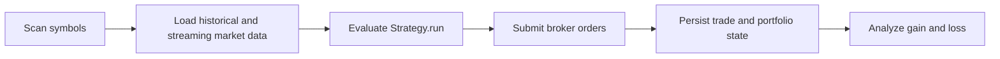
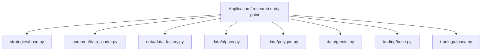
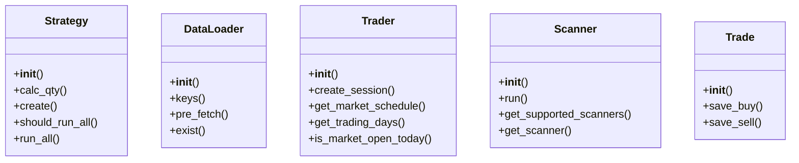
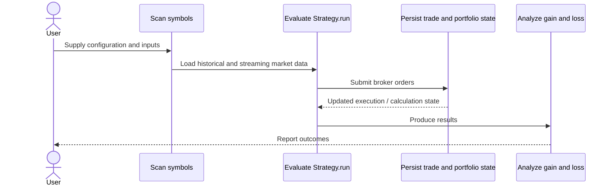
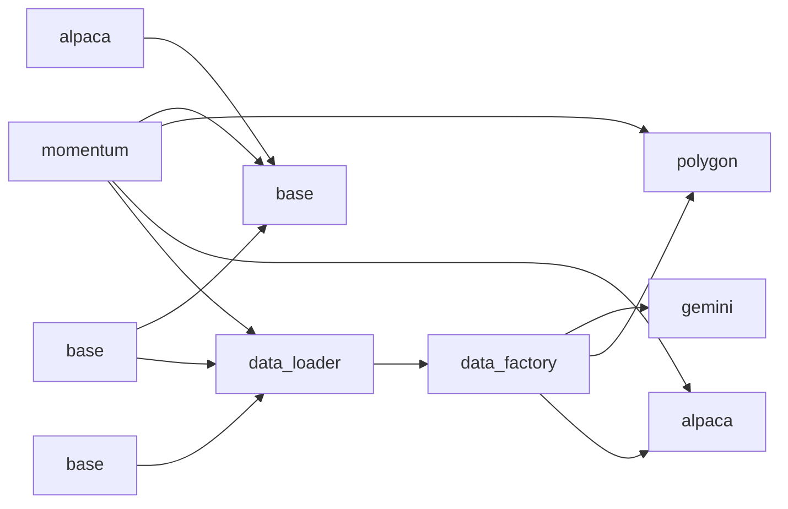
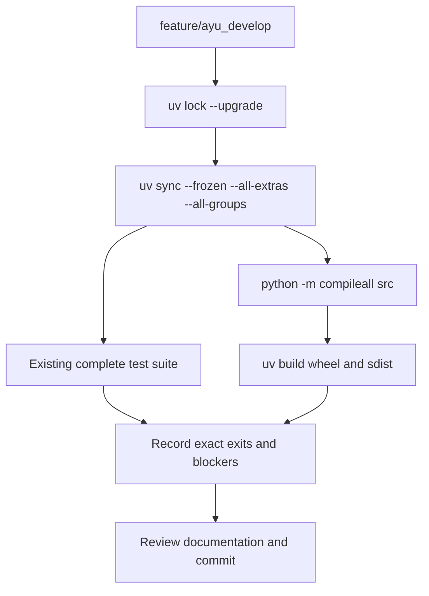

# LiuAlgoTrader: development, architecture and operations

Updated 2026-10-12 on `feature/ayu_develop`; source snapshot `6b6827697954`. This guide follows the source in this checkout and separates available interfaces from verification evidence.

## Purpose and feature boundaries

Live strategy execution, historical backtesting and operational analysis with separate scanning, data-provider, broker and PostgreSQL model layers.

Data provider and broker selection are distinct: market data arrives through DataAPI/StreamingAPI implementations, while Trader implementations handle order operations. Database models capture runs, portfolios and trade history; services and credentials are needed for integration tests.

## Main workflow

The following is the repository-specific logical workflow. Runtime execution details remain in the linked source and the validation record.

1. Scan symbols.
2. Load historical and streaming market data.
3. Evaluate Strategy.run.
4. Submit broker orders.
5. Persist trade and portfolio state.
6. Analyze gain and loss.

## Components and ownership

The entry point composes the source modules below; arrows indicate review/navigation boundaries rather than a claim that every module is called in every run.

| Source | Declared classes / functions | Implementation role |
|---|---|---|
| [src/liualgotrader/strategies/base.py](../src/liualgotrader/strategies/base.py) | StrategyType, Strategy | Base Class for Strategies |
| [src/liualgotrader/common/data_loader.py](../src/liualgotrader/common/data_loader.py) | SymbolData, DataLoader; _calc_data_to_fetch, convert_offset_to_datetime, handle_slice_conversion, load_item_by_offset | See the public declarations and implementation linked here. |
| [src/liualgotrader/data/data_factory.py](../src/liualgotrader/data/data_factory.py) | data_loader_factory, streaming_factory | See the public declarations and implementation linked here. |
| [src/liualgotrader/data/alpaca.py](../src/liualgotrader/data/alpaca.py) | AlpacaData, AlpacaStream; _is_crypto_symbol | See the public declarations and implementation linked here. |
| [src/liualgotrader/data/polygon.py](../src/liualgotrader/data/polygon.py) | PolygonData, PolygonStream | See the public declarations and implementation linked here. |
| [src/liualgotrader/data/gemini.py](../src/liualgotrader/data/gemini.py) | GeminiData, GeminiStream; requests_get | See the public declarations and implementation linked here. |
| [src/liualgotrader/trading/base.py](../src/liualgotrader/trading/base.py) | Trader | See the public declarations and implementation linked here. |
| [src/liualgotrader/trading/alpaca.py](../src/liualgotrader/trading/alpaca.py) | AlpacaTrader | See the public declarations and implementation linked here. |
| [src/liualgotrader/scanners/base.py](../src/liualgotrader/scanners/base.py) | Scanner | See the public declarations and implementation linked here. |
| [src/liualgotrader/scanners/momentum.py](../src/liualgotrader/scanners/momentum.py) | Momentum | See the public declarations and implementation linked here. |
| [src/liualgotrader/models/trades.py](../src/liualgotrader/models/trades.py) | Trade | See the public declarations and implementation linked here. |
| [src/liualgotrader/models/portfolio.py](../src/liualgotrader/models/portfolio.py) | Portfolio | See the public declarations and implementation linked here. |
| [src/liualgotrader/__init__.py](../src/liualgotrader/__init__.py) | Package data / configuration | See the public declarations and implementation linked here. |
| [src/liualgotrader/analytics/__init__.py](../src/liualgotrader/analytics/__init__.py) | Package data / configuration | See the public declarations and implementation linked here. |

## Class design

Methods and inheritance edges are taken from the selected declarations in the actual source. A missing edge means composition or an external base is not asserted here.

## End-to-end interaction

This sequence presents the responsibilities of the main workflow, including the state/result boundary. The linked classes and functions provide the exact method-level contract.

## Source dependency direction

These edges are actual explicit imports between the selected source modules. Dynamic imports, re-exports and third-party internals are omitted.

## Design details and extension points

### `Strategy`

Source: [src/liualgotrader/strategies/base.py](../src/liualgotrader/strategies/base.py).

The class contract is defined by its linked implementation.

- `calc_qty`: See implementation for the complete contract.
- `create`: Called by the framework upon instantiation. Must always call super() implementation.
- `should_run_all`: Called by the framework to select if to use the `run_all()` function, or `run()` function.
- `run_all`: Called by the framework, periodically, if `should_run_all()` returns True. This function, unlike `run()` is executed once, and not per symbol.
- `run`: Called by the framework, per symbol.

### `DataLoader`

Source: [src/liualgotrader/common/data_loader.py](../src/liualgotrader/common/data_loader.py).

The class contract is defined by its linked implementation.

- `keys`: See implementation for the complete contract.
- `pre_fetch`: See implementation for the complete contract.
- `exist`: See implementation for the complete contract.

### `Trader`

Source: [src/liualgotrader/trading/base.py](../src/liualgotrader/trading/base.py).

The class contract is defined by its linked implementation.

- `create_session`: See implementation for the complete contract.
- `get_market_schedule`: See implementation for the complete contract.
- `get_trading_days`: See implementation for the complete contract.
- `is_market_open_today`: See implementation for the complete contract.
- `is_market_open`: See implementation for the complete contract.

### `Scanner`

Source: [src/liualgotrader/scanners/base.py](../src/liualgotrader/scanners/base.py).

The class contract is defined by its linked implementation.

- `run`: See implementation for the complete contract.
- `get_supported_scanners`: See implementation for the complete contract.
- `get_scanner`: See implementation for the complete contract.

### `Trade`

Source: [src/liualgotrader/models/trades.py](../src/liualgotrader/models/trades.py).

The class contract is defined by its linked implementation.

- `save_buy`: See implementation for the complete contract.
- `save_sell`: See implementation for the complete contract.

## Repository layout and resources

Installable packages live under `src/`. `pyproject.toml` defines package metadata, build requirements, optional integrations and development dependencies; `uv.lock` records resolved versions, and `.python-version` selects the local interpreter. This layout keeps an accidental checkout import from substituting for the installed wheel. Package resources remain beside their owning modules and are included by the build backend. Existing upstream examples, fixtures, scripts and documentation retain their separate roles.

## Maintenance compatibility and evidence

- Python 3.14 exposes the Polygon 1.15.4 dataclass decorator assumption that __annotations__ is already materialized; existing full suite was therefore executed with managed 3.13.16.
- Polygon is constrained below 1.16 and Streamlit below 1.57 because the retained Alpaca trade SDK requires websockets<11. These are resolver-backed compatibility constraints.
- The full existing integration suite needs a configured PostgreSQL connection pool and Alpaca, Polygon, Tradier and other venue credentials. Missing setup produces 187 failures; no cases were disabled.

## Development and verification workflow

See [development commands](development.md) and [validation evidence](validation.md) for interpreter selection, dependency exceptions, full-suite results and remaining blockers. No additional test cases were introduced by this maintenance.
