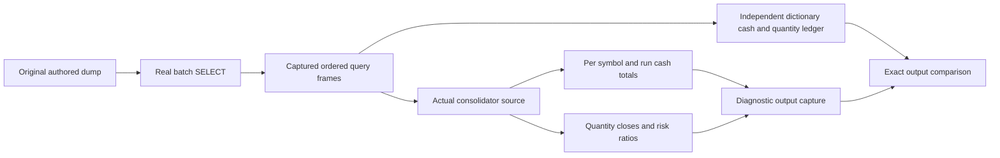

# Financial consolidation with current Pandas

The [consolidator](../src/liualgotrader/analytics/consolidate.py) now processes the three genuine batches in the [original PostgreSQL dump](../database/liu_dump.sql) with Pandas 3.0.6. Its cash, quantity, first notional, closing risk ratio and built-in two-place rounding formulas remain unchanged. The ordinary Hypothesis [consolidation case](../tests/test_consolidate.py) often selects nonexistent batches and returns early; passing that case alone does not establish financial processing.

## Compatibility boundary

The removed `DataFrame.append` call is replaced by `concat([gain_loss, DataFrame([the same original dictionary])], ignore_index=True)`. This retains row contents and ordering. The two scalar risk lookups use `Series.item()` only for the selected open position. The source creates a position only when that symbol/run has no open row, so that selection has at most one row. `item()` rejects ambiguous cardinality instead of silently choosing a row.

The percentage columns use the original scalar expression, `round(100.0 * float(ratio), 2)`, independently for each row. [Pandas 1.5.3 scalar conversion](https://github.com/pandas-dev/pandas/blob/v1.5.3/pandas/core/series.py) accepted only a one-row Series. The original whole-column conversion therefore already failed when a second group or position appeared. Row-wise mapping corrects that original multirow failure; it is not a claim of historical multirow output parity. No aggregate percentage is broadcast across distinct positions, and no financial assertion or expected value is changed.

## Authentic input and independent control

The unchanged loader filters joined `new_trades`/`algo_run` rows by the actual batch identifier, unexpired status and nonzero price, ordering by symbol and server timestamp. The control read these queries through an owned PostgreSQL pool configured with `default_transaction_read_only=on`, captured the returned DataFrames, and closed the pool in `finally`. It never called a database writer or supplied invented market rows.

The control executes the actual consolidator module. Only its connection/query boundary and persistence boundary are replaced by captured-input and output sinks in the diagnostic process. The trading calculations execute unchanged, apart from the three API repairs above. The independent ledger uses dictionaries and scalar arithmetic, with original cash signs, first notional, quantity closure, timestamps and rounding. It does not reuse the production DataFrame masks or column updates.

| Original batch | Input trades | Gain rows | Closed positions | Open positions |
|---|---:|---:|---:|---:|
| `a5f36d9c-7a84-48c7-aa2f-df092dcaea88` | 14 | 7 | 7 | 0 |
| `9111c17f-6200-4aeb-a5eb-779999956721` | 96 | 46 | 47 | 0 |
| `2398380c-5146-4b58-843a-a50c458c8071` | 96 | 46 | 47 | 0 |

All 206 input rows, 99 gain rows and 101 closed positions match the independent ledger exactly for cash, quantities, risk ratios, timestamps and percentages. For example, the genuine ACBI/run 7 group has cash gain `-38.70` on first notional `2833.70`, giving `-1.37%`; ADES/run 9 and run 11 each have `-76.25` on `763.75`, giving `-9.98%`.

A separate reference executes the exact original consolidator with the tagged Pandas 1.5.3 `_append` and scalar-coercion method source, using current DataFrame constructors. The real first group of each batch produces identical output values, dtypes and indexes. The original full batches reproduce the legacy multirow `TypeError`. This is a method-source compatibility reference, not an old Pandas binary runtime comparison.

## Recorded source identity and limits

- Original consolidator SHA-256: `7b658d0c55b88fe74d729f0766aab6c1ec559c72cdadd40e025c8fd7a3339387`.
- Repaired consolidator SHA-256: `94ae31cfcfcdda6b780964ba6b476a0d8ee907a57494067a105e92b1ee95cb4a`.
- Original dump SHA-256: `ccffa2a898d8522c578639d1a633c6625dd115d40ab62da00bc723f3375da28c`.

The diagnostic introduces no pytest cases and changes no existing tests, input dump, market rows, numeric settings or expected outputs. It verifies calculation and output construction on these authored batches; database insertion, broker execution, arbitrary unseen batches and the broader credential-dependent suite remain separate scopes.
